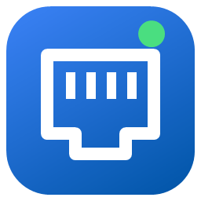

<p align="center"></p>
<h1 align="center">NetProbe</h1>
<p align="center">Laptop network tester &mdash; find the switch, port and VLAN behind any wall jack.</p>

<h2 align="center">Download</h2>

<table align="center">
  <tr>
    <td align="center" width="280">
      <a href="https://github.com/tylorfaber-arch/NetProbe/releases/latest/download/NetProbe-Setup.exe"><b>⬇&nbsp; Installer</b></a><br>
      <sub>NetProbe-Setup.exe<br>Start Menu shortcut &middot; auto-updates</sub>
    </td>
    <td align="center" width="280">
      <a href="https://github.com/tylorfaber-arch/NetProbe/releases/latest/download/NetProbe-Portable.exe"><b>⬇&nbsp; Portable</b></a><br>
      <sub>NetProbe-Portable.exe<br>Single file &middot; no install &middot; USB-friendly</sub>
    </td>
  </tr>
</table>

<p align="center">
  <sub><b>Requirements:</b> Windows 10 (2004 or newer) or Windows 11, 64-bit &nbsp;&middot;&nbsp; Administrator rights for switch port discovery &nbsp;&middot;&nbsp; Nothing else to install</sub><br>
  <sub>Windows may show a SmartScreen warning because the app isn't code-signed yet &mdash; click <b>More info &rarr; Run anyway</b>.</sub><br>
  <sub><a href="https://github.com/tylorfaber-arch/NetProbe/releases">All releases</a></sub>
</p>

<br>

---

## Features

| | |
|---|---|
| **Dashboard** | Link, IP/DHCP, Switch Port and Internet status at a glance, plus a live latency graph |
| **Switch port discovery** | LLDP and Cisco CDP: switch name, port, VLAN, voice VLAN, management IP, PoE, speed |
| **Port health** | Flags loops, broadcast storms, spanning-tree changes, rogue DHCP servers, duplicate IPs, speed/duplex mismatch, port errors and link drops |
| **Auto-run on plug-in** | Plug in a cable and the tests and switch discovery start on their own |
| **Link / IP** | Speed, MAC, IP, gateway, DHCP server and lease, DNS, Wi-Fi signal and channel |
| **Connectivity tests** | Gateway, DNS servers, internet, captive portal, HTTPS, public IP |
| **Latency** | Live gateway + internet ping graph with loss and jitter |
| **Tools** | Ping, traceroute, DNS lookup, TCP port check |
| **LAN scan** | Finds devices on the subnet with MAC and hostname |
| **Reports** | PDF, HTML or JSON, or copy a short summary for a ticket |
| **Light / dark** | Follows your Windows theme |

NetProbe asks for Administrator when it starts. Choose **No** to run in limited mode &mdash; everything except switch port discovery still works.

<br>

<details>
<summary><b>Building from source</b></summary>

Requirements: [.NET 10 SDK](https://dotnet.microsoft.com/download) and Inno Setup 6 (`winget install JRSoftware.InnoSetup`).

```powershell
powershell -ExecutionPolicy Bypass -File build\build.ps1
```

Output goes to `..\release\`: `NetProbe-Portable.exe` and `NetProbe-Setup.exe`.

</details>

<details>
<summary><b>Publishing an update</b></summary>

1. Bump `<Version>` in `NetProbe.csproj` (e.g. `2.0.1`).
2. Run `build\build.ps1`.
3. Create a GitHub Release tagged `v2.0.1` and attach `NetProbe-Setup.exe` and `NetProbe-Portable.exe`.

Installed copies find the new release on their next launch and offer to install it.

</details>

<!-- Remote upload is hidden in the app (App.RemoteUploadEnabled = false) until the portal is live.
     When it is, put this row back in the features table:
| **Remote upload** | Optional: send results to the NetProbe web portal |
     and remove this comment's start and end lines so the section below shows again.

<details>
<summary><b>Upload format (for a remote portal)</b></summary>

With an upload URL set, NetProbe sends `POST <url>` with `Authorization: Bearer <api key>` and this JSON:

```json
{
  "tool": "NetProbe", "version": "2.0.0", "timestampUtc": "...", "computer": "...", "tech": "...", "site": "...",
  "adapter":     { "Link": "Up", "Link speed": "1 Gbps", "IPv4 address": "..." },
  "switchPorts": [ { "Protocol": "LLDP", "Switch Name": "...", "Port ID": "...", "VLAN (native/untagged)": "20" } ],
  "tests":       [ { "result": "PASS", "test": "Ping gateway 10.0.0.1", "detail": "..." } ],
  "latency":     { "Gateway 10.0.0.1": "last 1 ms avg ..." },
  "lanScan":     [ { "ip": "...", "mac": "...", "hostname": "...", "ping": "...", "note": "" } ]
}
```

Any 2xx response counts as success. Optional extras a portal can support:

* Respond with JSON containing `"url": "https://..."` and NetProbe shows a **View this report in the portal** link.
* Answer `GET <url>` (same Bearer key) for **Test connection**. A JSON reply with `"org"` (and optionally
  `"uploadsThisMonth"` / `"monthlyLimit"`) shows "Connected to <org>"; 401/403 shows "API key rejected".
* On errors, a JSON body with `"error": "message"` is shown to the tech.

</details>
-->


<details>
<summary><b>Project layout</b></summary>

| Path | What |
|---|---|
| `MainWindow.xaml(.cs)` | UI: dashboard and pages |
| `Services/LinkDiscovery.cs` | pktmon capture + LLDP/CDP decoder |
| `Services/AdapterInfo.cs` | Link / IP / DHCP / Wi-Fi details |
| `Services/ConnectivityTests.cs` | Gateway, DNS, internet, captive portal checks |
| `Services/NetTools.cs` | Ping, traceroute, DNS lookup, port check |
| `Services/LanScanner.cs` | Ping + ARP sweep |
| `Services/LatencyMonitor.cs`, `Controls/LatencyGraph.cs` | Live latency |
| `Services/Report.cs` | Reports, upload, GitHub update check |
| `build/` | Build script, installer script, icon generator |

</details>

<sub>MIT License</sub>
